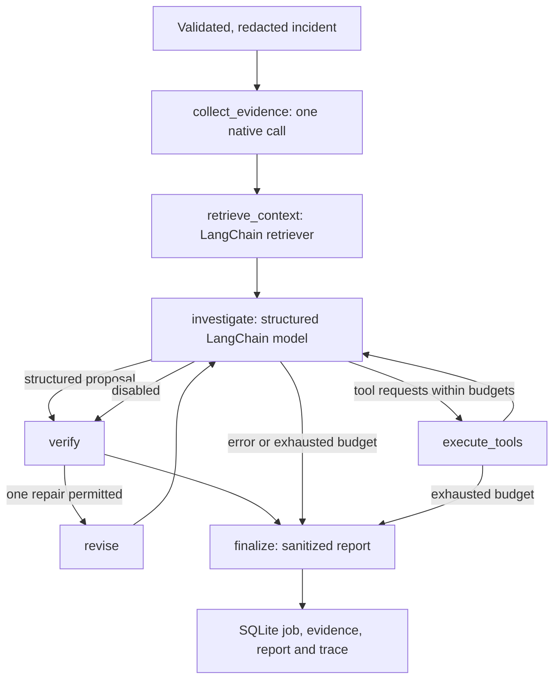

# AI Operations Copilot

A local/private incident investigation application combining C++17 telemetry analytics, Python/FastAPI, a SQLite knowledge index, LangChain adapters and a bounded LangGraph investigator. It runs without API credentials. The LLM proposes structured, evidence-referenced hypotheses and diagnostics; deterministic verification rejects unsupported references and numeric claims. No remediation is executed.

This is an unauthenticated portfolio application for a trusted local operator. It is **not suitable for public multi-user exposure**. Do not publish the API or put real sensitive incidents into an external model without authorization.

## Quick start (Linux, Python 3.12)

Prerequisites: Python 3.12 with venv, g++ with C++17 support, GNU make. Python 3.12 and g++ 14 were exercised. Dependencies are pinned in `requirements.txt` and all resolved versions in `constraints.txt`.

```bash
cd AI-Operations-Copilot
python3 -m venv .venv
. .venv/bin/activate
python -m pip install -r requirements-dev.txt
make -C cpp_engine
python -m app.investigation.cli init-db
python -m app.investigation.cli index
uvicorn app.main:app --host 127.0.0.1 --port 8000 --workers 1
```

Visit the local server in your browser. Select deterministic mode for zero provider calls. Submit numeric metric scalars/series and logs, inspect evidence, ranked candidates, contradictions, missing information, document provenance, concise traces and persisted history. Restarting retains completed jobs and marks unfinished jobs interrupted. Shutdown cancels retained tasks. Cancel queued/running jobs through the UI or API.

Use one application process, including the desktop client. Do not run desktop and API against the same database concurrently. This is bounded in-process background execution, not a distributed durable queue. Default concurrency is two with at most 32 retained jobs; native work runs in a thread and cancellation waits for an in-flight native call to exit. Jobs interrupted by restart are not automatically retried. History returns the latest 200 jobs; this demo has no retention-management UI.

## Optional real provider and semantic retrieval

Copy `.env.example` to `.env` and set `AIOPS_PROVIDER=openai` plus `AIOPS_API_KEY` securely. `OPENAI_API_KEY` in the process environment is also supported. Chat and embedding models default to `gpt-4.1-mini` and `text-embedding-3-small` (1536 dimensions). No call occurs on application startup. Selecting LLM mode is deliberate; unavailable credentials or failed investigations produce a labelled deterministic fallback, never fake model output.

```bash
# Explicit paid embedding operation over local, redacted Markdown runbooks:
python -m app.investigation.cli index --semantic
# Force embedding refresh after changing a model or dimensions:
python -m app.investigation.cli index --semantic --reindex
# Small opt-in live smoke evaluation: at most two synthetic incidents,
# two chat requests each, 30 seconds per incident; no real incident data.
python -m app.investigation.evaluate --live
```

The index stores chunk provenance, hashes, versions, vectors, embedding identity and dimensions in SQLite. Heading-aware chunks are at most 1800 characters. Unchanged content reuses embeddings. Deleted sources are removed during indexing. A changed embedding model/dimension invalidates semantic retrieval until reindexing; changed source documents are flagged as stale until indexing is rerun. Retrieval uses lexical token overlap and cosine similarity with explicit reciprocal-rank fusion and deduplication. Results have top-k and character budgets. Semantic query failure falls back to lexical retrieval.

Modes are reported as `hybrid`, `semantic`, `lexical_fallback`, `unavailable`, or fallback variants indicating incompatible/stale indexes. Keyword matching is not presented as semantic retrieval. Deterministic mode never embeds queries, even if a semantic index exists. Synthetic past-incident examples are labelled in each runbook.

External calls receive redacted descriptions, structured evidence/excerpts, selected runbook context, tool results and verification errors; embedding calls receive redacted document chunks or search queries. Redaction covers common keys, tokens, authorization headers, JWTs, URL credentials and private-key blocks. It cannot detect every secret or personal identifier. Review data before use. The provider receives no shell, SQL, arbitrary file or arbitrary network tool.

## Architecture



- **C++** classifies log patterns, computes statistical/threshold anomalies and correlates the already-computed results. `aiops_analyze_incident` runs each analyzer once. Original C ABI functions remain available.
- **LangChain** supplies the maintained OpenAI chat/embedding adapters and the operational `BaseRetriever` interface used during every investigation.
- **LangGraph** controls conditional tool requests, verification and one revision, with an independent recursion/step bound.
- **LLM** returns a schema-validated decision containing either permitted tool requests or a constrained proposal. It cannot supply arbitrary report prose, timestamps, infrastructure facts, numerical confidence probabilities or execution claims. This intentionally trades expressiveness for practical verification.
- **Verification** checks evidence ownership, support/contradiction membership, supplied citations, measured numerical values and action labels. Reference validity is not proof of semantic faithfulness. Prompt-injection separation and restricted output reduce risk; they do not guarantee immunity.
- **SQLite/SQLAlchemy** stores the redacted input, job status, stage history and complete validated result envelope (evidence, findings, hypotheses, chunk snapshots, citations, verification, provider metadata and trace). Schema v1 is additive and leaves the legacy `incidents` table untouched; newer unknown versions are rejected.

Defaults: four chat calls total, six tool calls, 24 graph steps, one revision, 45 seconds total, 15 seconds per provider request, 1800 output tokens. Chat SDK retries are disabled; the graph permits one repair/retry inside its total call budget. Embedding requests have one SDK retry and are bounded by the investigation timeout and tool budget. Timed-out HTTP work running in retrieval threads can finish after the logical deadline; its output is discarded. No private chain-of-thought is requested or stored.

Allowed tools: `get_log_evidence`, `get_metric_evidence`, `get_rule_hypotheses`, `search_runbooks`, `get_runbook_chunk`. Arguments use strict Pydantic contracts, each call must name the current incident, duplicate calls are rejected, and results are bounded. A chunk must have been retrieved in that investigation before direct lookup. API read endpoints are incident-scoped but unauthenticated; this is not tenant isolation.

## APIs and compatibility

- `GET /health/`, `GET /api/v1/engine/info`
- `POST /api/v1/incidents/`: enqueue validated incident, return job
- `GET /api/v1/incidents/`: recent persisted history
- `GET /api/v1/incidents/{id}`: status and completed report
- `POST /api/v1/incidents/{id}/cancel`
- `GET /api/v1/incidents/{id}/evidence`, `/citations`, `/trace`, `/stages`
- `POST /analyze/`: wait for the same shared service; returns job fields plus legacy `plan`, `root_cause`, `recommendations`, `report` fields

Original report fields remain, including `confidence_score` as a compatibility-only **uncalibrated heuristic score**. The dashboard never describes it as a probability. `is_safe` is false by default; recommendations carry action labels. Completion does not claim resolution. Deterministic tables use measured values directly; disk pressure does not imply 100% utilization. Descriptions never drive deterministic category selection.

Input limits: 10,000 description characters, 2,000 log entries, 100,000 log characters total, 4,000 per line, 100 metrics, 10,000 samples per metric; finite numeric values of magnitude at most 1e100. Metric names use an ASCII identifier-like grammar. Booleans, numeric strings, empty series and nonfinite values are rejected.

## Validation and evaluation

```bash
python tests/test_cpp_core.py
python tests/test_e2e_workflow.py
python -m pytest -q
python -m app.investigation.evaluate --output docs/evaluation-results.json
# Start the server on port 8010 first:
python tests/browser_smoke.py --url http://127.0.0.1:8010
```

The browser smoke uses Playwright with `/usr/bin/chromium`; install Chromium through your OS package manager or adapt the executable path. Fake providers and fake embedding vectors exist only in tests, are explicitly labelled, and never enter production fallback. The adapter test uses the real LangChain integration over a synthetic HTTP transport; it does not verify OpenAI service access.

Committed evaluation results report **11/11 synthetic category labels** and **8/8 lexical document recall@4 queries**. These are tiny authored regression fixtures, not production accuracy or semantic-retrieval quality measurements. Healthy telemetry, conflicting symptoms, insufficient evidence, misleading descriptions and injection text are included. Citation validity is vacuous when there are no model citations; the separate fake-provider tests exercise valid/fabricated references and numeric inconsistencies. Live chat/embedding service behavior and real semantic retrieval quality remain unverified without credentials.

## Desktop and containers

```bash
python -m pip install -r requirements-desktop.txt
python app/ui/desktop_app.py
```

The desktop uses the same service in deterministic mode and displays actual analytics/retrieval/provider modes. It was smoke-tested offscreen with PyQt6. Interactive desktop behavior on Windows/macOS has not been tested. On Windows, `cpp_engine\build.bat` now anchors paths to its own directory; rebuild the DLL locally rather than relying on the old checked-in binary.

```bash
docker build -t aiops-local .
docker run --rm -p 127.0.0.1:8000:8000 -v aiops-data:/data aiops-local
```

The image runs as a non-root user with one worker, initializes schema and a lexical index, and stores data under `/data`. The internal listener uses 0.0.0.0 for container networking; keep the host port bound to 127.0.0.1. In a TLS-inspecting build environment, pass `--secret id=proxy_ca,src=/path/to/combined-ca.pem`; verification remains enabled. `render.yaml` is a deployment example, not an authorization to expose this unauthenticated app publicly.

See [requirement reconciliation](docs/requirements.md), [official API references](docs/dependencies.md), and [implementation checklist](IMPLEMENTATION_CHECKLIST.md).
