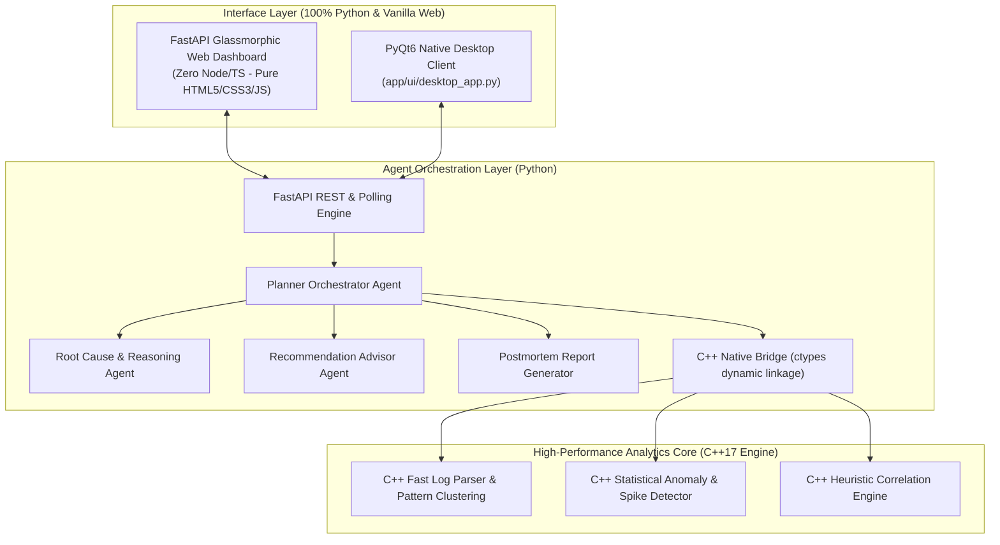

# AI Operations Copilot — Agentic Incident Analysis Platform (100% C++ & Python)

## 1. System Overview & Architecture

The **AI Operations Copilot** is a high-performance, deterministic planner-based agentic platform built entirely in **C++ and Python** (0% TypeScript / Node.js). It ingests logs, metrics telemetry, and alerts to infer root causes and generate structured, explainable postmortem reports with safe, read-only remediation steps.



---

## 2. Technology Stack & Language Breakdown

- **Core Analytics Engine (C++17)**:
  - Multithreaded regex log pattern matching & frequency clustering (`cpp_engine/src/log_analyzer.cpp`).
  - Statistical time-series anomaly detection with Z-score spike calculation (`cpp_engine/src/metrics_analyzer.cpp`).
  - Heuristic cross-domain incident correlator (`cpp_engine/src/correlator.cpp`).
  - Compiled shared library (`app/lib/aiops_core.dll` / `.so`).
- **Agent Orchestrator & Backend (Python 3.10+)**:
  - `FastAPI` & `Uvicorn` for async API endpoints & static dashboard hosting.
  - `Pydantic v2` for strict input/output telemetry models.
  - Native `ctypes` bridge with dynamic loading and automatic fallback.
- **Frontend & User Interfaces**:
  - **Glassmorphic Web Dashboard**: Self-contained HTML5/CSS3/Vanilla JS served directly by FastAPI (zero node_modules, zero TypeScript compilation).
  - **Native Desktop Application**: Standalone desktop GUI powered by `PyQt6` (`app/ui/desktop_app.py`).

---

## 3. Directory Structure

```
├── cpp_engine/              # C++17 High-Performance Core Engine
│   ├── include/             # C++ Headers & C ABI definitions
│   │   ├── c_api.h
│   │   ├── correlator.hpp
│   │   ├── log_analyzer.hpp
│   │   └── metrics_analyzer.hpp
│   ├── src/                 # C++ Source Code
│   │   ├── c_api.cpp
│   │   ├── correlator.cpp
│   │   ├── log_analyzer.cpp
│   │   └── metrics_analyzer.cpp
│   ├── build.bat            # Windows g++ compilation script
│   └── Makefile             # Linux/macOS build script
├── app/                     # Python Orchestration & Agent Framework
│   ├── agents/              # Domain Agents (Log, Metrics, RCA, Recommendation, Report)
│   ├── core/                # Planner, Workflow, C++ Bridge, Config
│   ├── lib/                 # Compiled C++ Shared Library (aiops_core.dll)
│   ├── schemas/             # Pydantic Data Models
│   ├── static/              # CSS & Vanilla JS for Web Dashboard
│   ├── templates/           # HTML Dashboard Templates
│   ├── ui/                  # PyQt6 Native Desktop GUI Application
│   └── main.py              # FastAPI Application Entrypoint
├── tests/                   # Integration & E2E Test Suite
│   ├── test_cpp_core.py     # C++ Native Bridge & Analytics Tests
│   └── test_e2e_workflow.py # Full Asynchronous Incident Lifecycle Tests
├── requirements.txt         # Python Dependencies
└── README.md
```

---

## 4. Build & Run Instructions

### Prerequisites
- Python 3.10+ (e.g. Anaconda / Miniconda / Python 3.13)
- C++ Compiler with C++17 support (`g++` / MinGW / Clang / MSVC)

### Step 1: Install Python Dependencies
```bash
pip install -r requirements.txt
```

### Step 2: Compile C++ Core Engine
**On Windows (PowerShell / CMD):**
```powershell
.\cpp_engine\build.bat
```
*Or directly via g++:*
```powershell
g++ -std=c++17 -O3 -shared -fPIC -Icpp_engine/include cpp_engine/src/log_analyzer.cpp cpp_engine/src/metrics_analyzer.cpp cpp_engine/src/correlator.cpp cpp_engine/src/c_api.cpp -o app/lib/aiops_core.dll -static-libgcc -static-libstdc++
```

**On Linux / macOS:**
```bash
make -C cpp_engine
```

### Step 3: Run the Test Suite
```bash
python tests/test_cpp_core.py
python tests/test_e2e_workflow.py
```

### Step 4: Launch the Web Dashboard
```bash
uvicorn app.main:app --reload --port 8000
```
Open your browser at: **`http://localhost:8000`**

### Step 5: (Optional) Launch the PyQt6 Native Desktop App
```bash
python app/ui/desktop_app.py
```

---

## 5. API Endpoints

- `GET /` — Serves the interactive Glassmorphic Incident Studio & Dashboard.
- `GET /api/v1/engine/info` — Returns metadata about the active C++ core engine and runtime environment.
- `POST /api/v1/incidents/` — Submits a new incident payload for asynchronous C++ and agent analysis.
- `GET /api/v1/incidents/{job_id}` — Polls the live status, current pipeline step, and generated markdown postmortem report.
- `GET /api/v1/incidents/` — Lists all tracked incidents in the active session.
